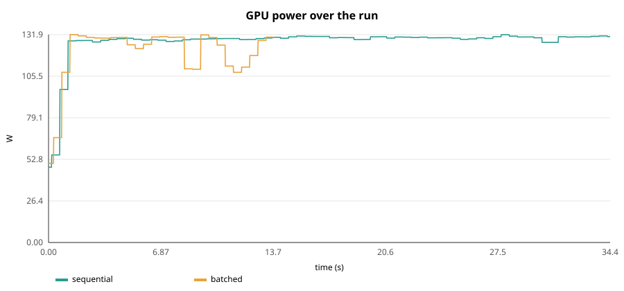

# AVIS — Energy-Aware LLM Inference

[](https://github.com/goutham-226/AVIS_ENERGY_AWARE_INFERENCE/actions/workflows/ci.yml)


AVIS is an LLM inference engine, written in C++23 on top of llama.cpp, that serves many concurrent requests on one NVIDIA GPU while managing energy. It combines a continuous-batching scheduler, a paged KV-cache block manager with prefix caching, and a closed-loop GPU clock controller. The controller looks for the lowest SM clock that keeps latency inside a budget you set.

## Results

Measured on an **NVIDIA GeForce RTX 5050 (8 GB, 130 W)** with **Llama-3.2-3B-Instruct Q4_K_M**. The workload was 32 requests arriving as a seeded Poisson process at 2 req/s, 128 generated tokens each, 16 prompts sharing a system prompt. Each scenario ran twice in rotated order; the two runs agreed within 1%. Energy comes from the NVML board energy counter over the whole serving window.

| Scenario | Throughput | Energy / token | Tokens / J | TTFT p50 | TPOT p50 | E2E p50 | E2E p95 |
| --- | ---: | ---: | ---: | ---: | ---: | ---: | ---: |
| `sequential` (original prototype: one request at a time) | 119 tok/s | 1.087 J | 0.92 | 9.64 s | 8.3 ms | 10.70 s | 21.00 s |
| `batched` (continuous batching + paged KV + prefix cache) | **296 tok/s** | **0.422 J** | **2.37** | **0.02 s** | 11.8 ms | **1.52 s** | **1.71 s** |
| **Change** | **2.5×** | **−61%** | **2.6×** | **−99.8%** | +42% | **−86%** | **−92%** |

When requests share each forward pass, the weights are read once per step for up to eight requests instead of once per request. That makes each token far cheaper in energy and removes the queueing that dominated the sequential baseline's latency. Per-token decode time rises by 42% because eight sequences share each step, yet end-to-end latency still falls by 86–92%.



The trace shows the GPU sitting at its 130 W board limit with the SM clock near 2.9 GHz, even though decode is memory-bound. That headroom is what the energy-aware clock policy targets. Its hardware results need root and are produced with:

```bash
sudo ./build/avis bench --requests 48 --rate 3 --max-tokens 128 \
     --scenarios batched,fixed:2400,fixed:1900,fixed:1500,fixed:1200 --out results/sweep
sudo ./build/avis bench --requests 48 --rate 3 --max-tokens 128 \
     --scenarios batched,avis --repeat 3 --latency-budget 0.10 --out results/avis
```

## Features

| Area | What AVIS does |
| --- | --- |
| **Scheduling** | Iteration-level continuous batching: every forward pass mixes decode tokens of running requests with chunked prefills of new ones, bounded by a per-step token budget. Decode is scheduled first to keep inter-token latency stable. |
| **Paged KV cache** | vLLM-style block manager: fixed-size KV blocks, per-sequence block tables, reference counting, watermark-gated admission and recompute preemption when memory runs out. |
| **Prefix caching** | Full blocks are hashed (chained with their prefix). Requests that share a prompt prefix (e.g. a system prompt) reuse the same physical KV, mapped onto llama.cpp's unified cache with `llama_memory_seq_cp`, so no data is copied. Finished sequences stay cached in idle slots until evicted (LRU). |
| **Energy-aware clocks** | A windowed feedback controller caps the SM clock. It measures step-time slowdown against max-clock references bucketed by batch size and moves the cap within a latency budget (default 10%). It raises clocks when the queue saturates and recalibrates periodically. |
| **Telemetry** | NVML power, clocks, utilisation and temperature sampled on a `std::jthread`. Energy comes from the GPU's hardware energy counter, with trapezoidal integration as a fallback. |
| **Graphs** | Terminal power, cumulative-energy and SM-clock charts (Unicode braille) and bar charts, plus SVG and CSV export. |
| **Benchmarking** | `avis bench` replays a seeded Poisson workload under several scenarios and reports J/token, tokens/J, throughput, TTFT, TPOT and end-to-end p50/p95. Google Benchmark micro-benchmarks cover the CPU hot paths. |

### Why the clock policy works per window, not per phase

The original prototype raised the clock for prefill and lowered it for decode. That stops working once requests are batched continuously, because a single `llama_decode` call carries one request's prefill chunk next to other requests' decode tokens, so there are no separate phases to clock. Changing clocks through NVML also takes about as long as a whole step.

AVIS therefore chooses one cap for the whole batch stream and revises it at most once per control window (300 ms by default):

```
every step:   slowdown_sample = step_time / reference[bucket(num_tokens)]     (references measured at max clock)
every window: saturated (full batch + queue)      -> cap += 2 levels
              mean slowdown > latency_budget      -> cap += 1 level
              mean slowdown < latency_budget / 2  -> cap -= 1 level
every ~10 s:  one window at max clock to refresh the references
```

The cap is applied as `nvmlDeviceSetGpuLockedClocks(min_supported, cap)`, which limits the maximum clock only, so the GPU can still drop to idle clocks when there is no work.

## Architecture

```
            submit() from any thread                     ┌──────────────────────────────┐
  client ─────────────────────────────► Engine (jthread) │ ClockPolicy                  │
     ▲         std::future<Output>        │   │      ▲   │  default / fixed / energy-   │
     │                                     │   │      └───┤  aware (windowed feedback)   │
     │  streamed text (on_text)            │   │  StepObservation   │ NVML cap           │
     └─────────────────────────────────────┘   ▼                    ▼                    │
                                     Scheduler ──► StepPlan ──► Executor (llama.cpp) ── GPU
                                         │       chunks + KV ops     │ unified KV cache, seq_cp/seq_rm
                                         ▼                           │ one mixed batch per step
                                   BlockManager                      ▼
                         blocks · block tables · prefix hashes   PowerSampler / EnergyMeter (NVML)
```

The core library (`avis_core`) has no dependency on llama.cpp or NVML: the scheduler, block manager, clock policy, engine, telemetry interfaces and reporting are all unit-tested against fakes. `avis_llama` and `avis_nvml` plug in the real backend and GPU.

## Getting started

Requirements: Linux, an NVIDIA GPU with drivers (NVML), CUDA toolkit, CMake ≥ 3.28, Ninja and a C++23 compiler (GCC 14+ or Clang 18+).

```bash
# 1. Dependencies: llama.cpp (pinned, CUDA build) into third_party/, GGUF models into models/
scripts/setup_deps.sh

# 2. Build (GoogleTest and Google Benchmark are fetched by CMake)
cmake -S . -B build -G Ninja
cmake --build build

# 3. Test
ctest --test-dir build --output-on-failure        # unit + real-model integration tests
./build/bench/avis_micro_bench                    # CPU hot-path micro-benchmarks
```

`third_party/`, `models/`, `build/` and `results/` are git-ignored.

## Usage

```bash
./build/avis info                                   # GPU, energy counter, clock-control status

./build/avis run --prompt "Why is decode memory-bound?" --max-tokens 256
#   streams the answer, then prints latency, energy (J, W, J/token, tokens/J)
#   and graphs of GPU power and cumulative energy

sudo ./build/avis bench --requests 48 --rate 3 --max-tokens 128 \
     --scenarios sequential,batched,avis --repeat 3 --latency-budget 0.10
#   comparison tables, J/token + throughput bar charts, power and SM-clock graphs,
#   results/summary.csv, per-run power traces, results/power.svg, results/sm_clock.svg
```

Clock control needs root (`nvmlDeviceSetGpuLockedClocks`). Without it, AVIS still serves and measures everything, and the `avis` scenario runs at default clocks. AVIS resets any clock lock it applied when the engine shuts down.

| Scenario | Meaning |
| --- | --- |
| `sequential` | one request at a time at default clocks (the original prototype's behaviour) |
| `batched` | continuous batching + paged KV + prefix caching at default clocks |
| `avis` | `batched` + the energy-aware clock controller |
| `fixed:<MHz>` | `batched` with a fixed SM clock cap (useful for sweeps) |

Run `./build/avis help` for every option (context size, batch limits, prefill chunk, latency budget, control window, clock floor, seed, cooldown…).

## Project layout

```
apps/avis.cpp                 CLI: info / run / bench
include/avis/core             Result/Error types, clocks
include/avis/kv               paged KV block manager + prefix cache
include/avis/engine           requests, scheduler, clock policies, engine, executor interface
include/avis/llama            llama.cpp executor
include/avis/telemetry        GPU device interface, NVML device, power sampler, energy meter
include/avis/workload         prompt file parser, Poisson arrivals
include/avis/report           statistics, terminal/SVG charts
include/avis/bench            scenario runner
tests/                        GoogleTest unit tests (fakes) + real-model integration tests
bench/                        Google Benchmark micro-benchmarks
scripts/setup_deps.sh         llama.cpp + model setup
prompts.txt                   benchmark workload
```

## Notes and limitations

- **Paged attention scope.** KV memory is managed as pages at the scheduler level: allocation, admission, sharing and preemption. Attention itself runs in llama.cpp's kernels (flash attention when available) over its unified KV cache, which places cells non-contiguously. AVIS does not ship custom paged-attention CUDA kernels.
- **Batch non-invariance.** As in other engines, batched kernels round slightly differently from single-sequence ones, so long greedy continuations can fork at near-ties. The integration tests check context isolation and determinism rather than bit-exact equality with single-request output.
- **Measurement.** Energy is board energy from NVML for the whole serving window, idle gaps between arrivals included. `--repeat` rotates the scenario order to spread thermal drift.

## Roadmap

- HTTP/OpenAI-compatible front end on top of `Engine::submit`
- Multi-GPU (tensor parallel) serving and per-GPU clock control
- Memory-clock and power-limit control alongside SM clocks
- Speculative decoding
